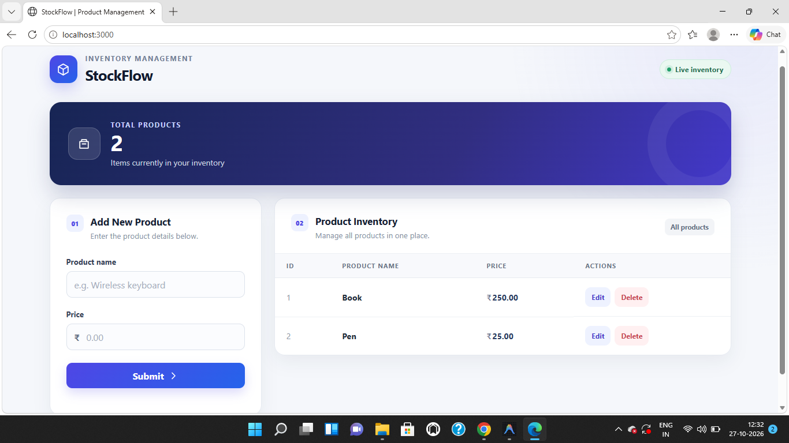
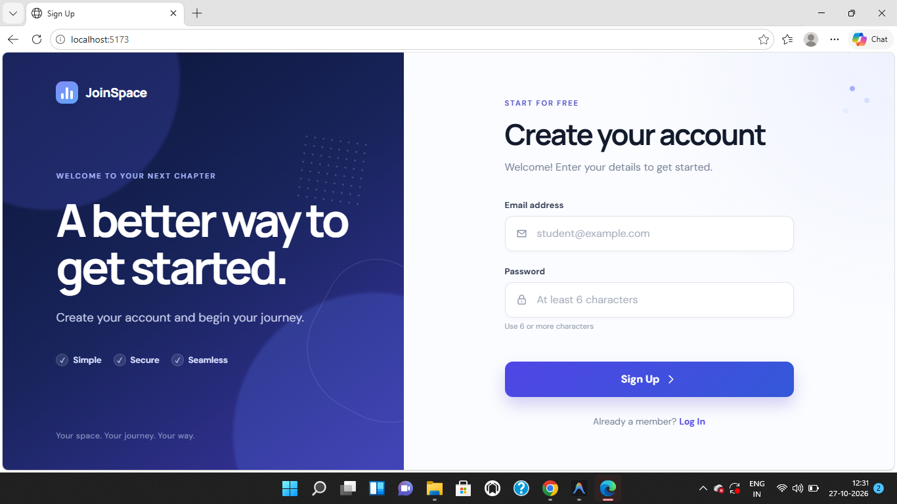

# MERN Lab Assignments

A collection of two web development lab assignments built using HTML, CSS, JavaScript, React, Express.js, REST APIs, and MongoDB.

## Task 1 — StockFlow: CRUD Operations

A product inventory management application supporting Create, Read, Update, and Delete operations using an in-memory JavaScript array.

**Tech Stack:** HTML, CSS, JavaScript, Node.js, Express.js, REST API.

### Screenshot



## Task 2 — JoinSpace: User Signup

A user registration application with input validation, password hashing, and MongoDB database integration.

**Tech Stack:** React, CSS, Node.js, Express.js, MongoDB, Mongoose.

### Screenshot



## Getting Started

### Task 1

```bash
cd task1-crud
npm install
npm start
```

Open `http://localhost:3000`.

### Task 2

Configure the backend environment first. Copy `task2-signup/server/.env.example` to `task2-signup/server/.env`, then set `MONGODB_URI` to your MongoDB connection string.

Start the backend:

```bash
cd task2-signup/server
npm install
npm start
```

In a second terminal, start the React client:

```bash
cd task2-signup/client
npm install
npm run dev
```

Open `http://localhost:5173`.

## Author

Aman Hegde

GitHub: [github.com/Aman-Hegde](https://github.com/Aman-Hegde)
